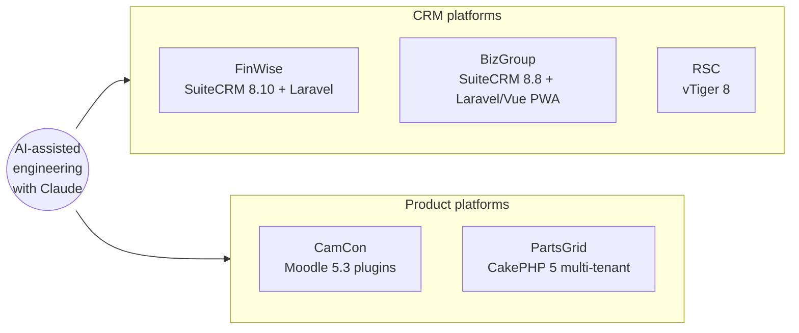

# Loganathan C — Project Portfolio

**Solution Architect · 22+ years** across CRM (SugarCRM, SuiteCRM, vTiger), cloud (AWS, IBM Cloud) and full-stack web (LAMP, Java, JavaScript), now focused on **AI-assisted engineering**.

This repository shows enterprise applications I designed and built recently. They range from modernised CRM platforms to new multi-tenant products, all developed in an AI-assisted workflow with Claude. Each project page covers the business domain, tech stack, architecture, features and key flows, with diagrams.

> 🔒 **The source code is private.** Each project's code is kept in its own private repository. To review the code, [**request access**](https://github.com/loganathan-expertise/project-portfolio/issues/new?template=access-request.yml), and I'll add you as a read-only collaborator.

---

## Projects

| | Project | Domain | Core stack | Details | Source |
|---|---|---|---|---|---|
| 🎓 | **[CamCon — Campus Connect](camcon/)** | EdTech · campus hiring | Moodle 5.3 LTS · PHP 8.4/8.5 · MariaDB · Moodle app | [View project →](camcon/) | 🔒 [Private repo](https://github.com/loganathan-expertise/camcon) |
| 🔧 | **[PartsGrid](partsgrid/)** | Retail · automotive spare parts (multi-tenant SaaS) | CakePHP 5 · PHP 8.2 · MySQL · PWA | [View project →](partsgrid/) | 🔒 [Private repo](https://github.com/loganathan-expertise/partsgrid) |
| 💰 | **[FinWise](finwise/)** | FinTech · loan marketplace | SuiteCRM 8.10 · Laravel 13 · MariaDB 12 · OAuth2 | [View project →](finwise/) | 🔒 [Private repo](https://github.com/loganathan-expertise/finwise) |
| 🤝 | **[BizGroup](bizgroup/)** | Business networking · membership | SuiteCRM 8.8 · Laravel 8 + Vue 2 PWA · MySQL | [View project →](bizgroup/) | 🔒 [Private repo](https://github.com/loganathan-expertise/bizgroup) |
| 📷 | **[RSC — Rent Sell Cameras (ClickPix)](rsc/)** | Equipment rental · loan tracking | vTiger CRM 8 · PHP 8.2 · MySQL 5.7 | [View project →](rsc/) | 🔒 [Private repo](https://github.com/loganathan-expertise/rsc) |

### At a glance

| Project | Type of work | Users | Highlights |
|---|---|---|---|
| CamCon | Greenfield platform on an LMS | Students, colleges, companies, platform admin | 8 custom Moodle plugins plus a theme, with no core changes; learning → projects → interviews → offer e-signature → onboarding; help desk, insights, mobile app |
| PartsGrid | Greenfield multi-tenant SaaS | Business owners, cashiers, warehouse, garages (B2B), consumers, riders | Shared-DB tenancy with an ORM guard; order allocation from store to any location to vendor drop-ship to backorder; GST invoicing; rentals; OTP delivery; 3 PWAs |
| FinWise | Rebuild of a 2014–15 enterprise CRM from its specification | Customers, channel partners, lenders, sales and ops staff | 8 custom CRM modules, custom V8 REST API, offers engine (EMI/FOIR), partner empanelment auto-approval, lender credit desk |
| BizGroup | Port and modernisation of a legacy SugarCRM system to SuiteCRM 8 | Members, circle leaders, office staff | 12+ custom modules, a member portal PWA backed by a CRM API, secure invite and member-token flow, Android TWA wrapper |
| RSC | Revival and hardening of a legacy vTiger system | Loan desk staff, photographers | Fixed PHP 8 fatal errors, closed SQL-injection and CSRF holes, full rebrand, anonymised sample DB |

---

## How I work

- **Architecture first.** I write a solution approach (architecture, data model, flows) and review it before building.
- **No core hacks.** CRM and LMS work goes through the platform's extension points (logic hooks, extension framework, Moodle plugins), so upgrades stay routine.
- **Security by default.** Every project includes OAuth2 between portal and CRM, signed webhooks, hashed one-time tokens, CSRF protection, server-side permission checks and tenant isolation.
- **Delivered with documentation.** Each project ships with an architecture/design/flow document, a user manual, an installation guide and an anonymised demo dataset.

## Requesting code access

1. Open an [access request](https://github.com/loganathan-expertise/project-portfolio/issues/new?template=access-request.yml) with your name, company, GitHub username and the projects you'd like to review.
2. I'll add you as a **read-only collaborator** on those private repositories. Access is normally granted for the review period.
3. For a live walkthrough or demo instead, mention it in the request.

---

All screenshots and sample data are fictitious. Product names in this portfolio (CamCon, PartsGrid, FinWise, BizGroup, ClickPix) are project brands, not real companies. © Loganathan C. All rights reserved. The content of this repository may not be reused without permission.
