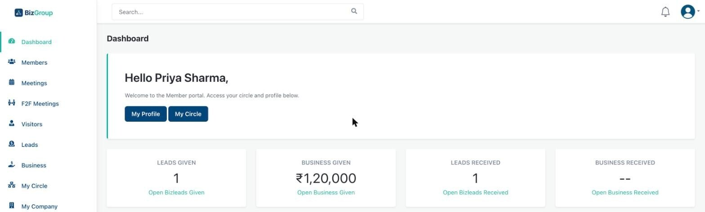
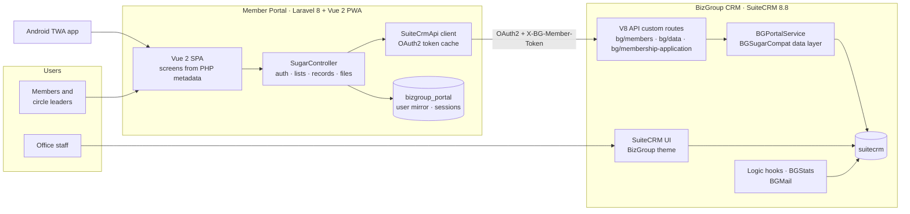
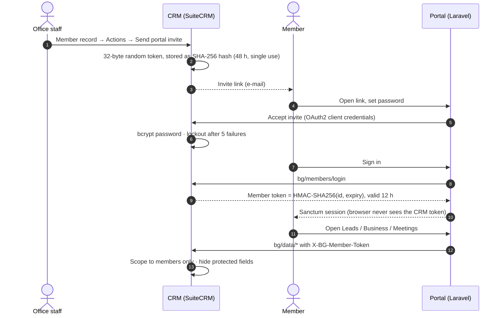
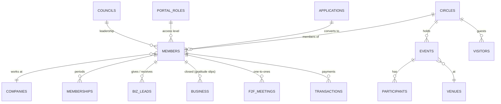
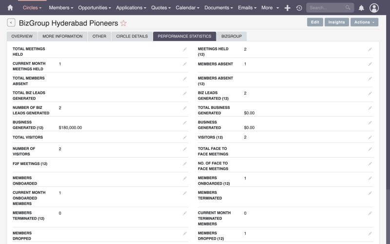
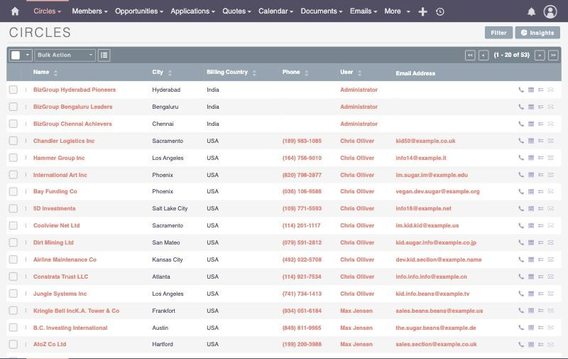

# BizGroup — CRM and Member Portal

**A management system for a business-referral network.** Members meet in local *circles*, pass business leads to each other, record the business closed, and hold one-to-one meetings. The office runs the network from the CRM, and members use an installable portal.

[← All projects](../README.md) · 🔒 **Source code:** private repo [`loganathan-expertise/bizgroup`](https://github.com/loganathan-expertise/bizgroup) · [Request access](https://github.com/loganathan-expertise/project-portfolio/issues/new?template=access-request.yml)

| | |
|---|---|
| **Domain** | Business networking · membership organisations · referral tracking |
| **Type** | Port and modernisation of a legacy SugarCRM implementation to SuiteCRM 8, with a full rebrand |
| **Status** | Complete; handed over with user manuals, a technical handover document, backups and brand assets |
| **Users** | Members, circle leaders, office staff, administrators |

---

## What was done

- **Ported the full customisation** (data model, layouts, logic hooks, statistics and portal API) from a commercial SugarCRM instance to **open-source SuiteCRM 8.8**. The port used sample records only, no real member data.
- **Rebuilt the portal-to-CRM integration** on SuiteCRM's V8 API with OAuth2, and **fixed the security flaws** in the legacy portal and website API along the way.
- **Rebranded everything to BizGroup:** code, database identifiers, labels, logo, app icons and splash screens, leaving no legacy references.
- **Wrote the handover pack:** CRM user manual, member portal guide, technical handover (architecture, operations, backup and restore) and starter databases.

## Tech stack

| Layer | Technology |
|---|---|
| CRM | SuiteCRM 8.8 (Symfony + Angular shell, legacy module layer) on PHP 8.2 |
| Member portal | Laravel 8 API + Vue 2 SPA, installable PWA, Laravel Sanctum |
| Android | Trusted Web Activity wrapper around the PWA |
| Database | MySQL 5.7: `suitecrm` (275 tables), `bizgroup_portal` (users, sessions, jobs) |
| Integration | SuiteCRM V8 REST API, custom routes `bg/*`, OAuth2 client credentials |
| Web server | Apache 2.4 (FastCGI), virtual hosts for the CRM and the portal |

## Architecture

**The portal holds no business data.** It reads and writes everything through the CRM's custom API. The portal's screens (modules, tabs, fields, filters, buttons and access levels) are defined as PHP metadata, so new screens need no front-end code.

### Member invite and sign-in

## CRM data model

| Module | Shown as | Purpose |
|---|---|---|
| Accounts | Circles | Circles with calculated performance statistics |
| Contacts | Members | Members, with portal role, invite and lockout fields |
| Leads / Prospects | Applications / Visitors | Membership applications and meeting guests |
| BZ_Biz_Leads | Biz Leads | Referrals between members, across circles |
| BU_Business | Business | Business closed (gratitude slips) |
| BFM_F2F_Meetings | F2F Meetings | One-to-one meetings |
| BH_Companies · BM_Memberships · BS_Councils | Companies · Memberships · Councils | Member companies, membership periods, leadership councils |
| BH_Events · BH_Participants · BH_Venues | Events | Events, attendance and venues |
| BT_Transactions | Transactions | Payments and purchases |
| BG_PortalRoles | Portal Roles | Access level for each portal feature |

## Features

| Area | What's included |
|---|---|
| **Circle performance** | Automatic statistics per circle (meetings, attendance, leads, business, visitors, F2F meetings, onboarding and attrition), for the current month and a rolling 12 months |
| **Member portal** | Dashboard (leads and business given and received), members directory, meetings and attendance, F2F meetings, visitors, leads, business, my circle, my company, my profile |
| **Access control** | Portal Roles module controls which portal features each member level can use, without code changes |
| **Membership** | Online applications, invites, memberships and renewals, councils |
| **Events** | Events, venues, participants and attendance |
| **Mobile** | Installable PWA, plus an Android TWA wrapper ready for a store build |

## Engineering highlights

- **Upgrade-safe customisation:** no SuiteCRM core edits. Everything lives in the extension framework (`custom/`), custom modules and a Symfony extension for record actions.
- **SuiteCRM 8 specifics solved,** for example a currency field needs a companion `currency_id` before SuiteCRM 8 can render the record.
- **Security:** hashed single-use invite tokens, an HMAC member token, bcrypt with lockout, protected fields never exposed through the API, and data scoped to members only.
- **Repeatable rebrand:** a scripted rename tool, with backups taken before and after each step.

---

[← All projects](../README.md) · 🔒 [Request code access](https://github.com/loganathan-expertise/project-portfolio/issues/new?template=access-request.yml)
