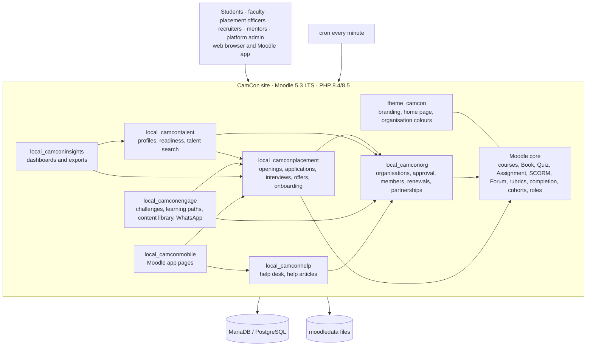
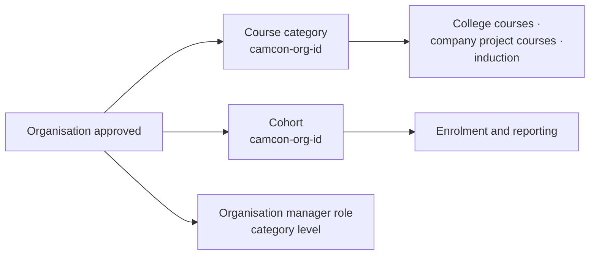
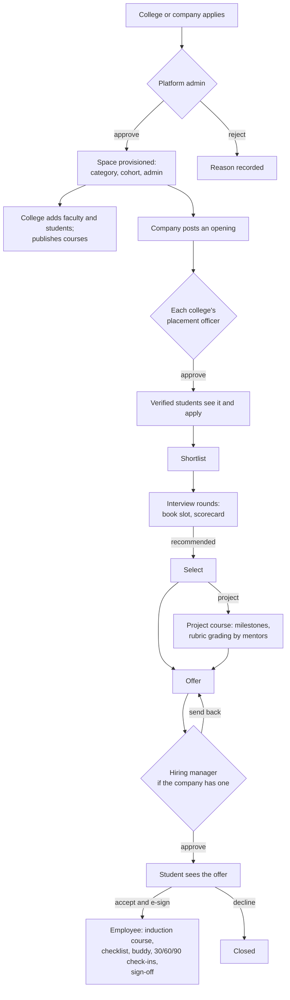
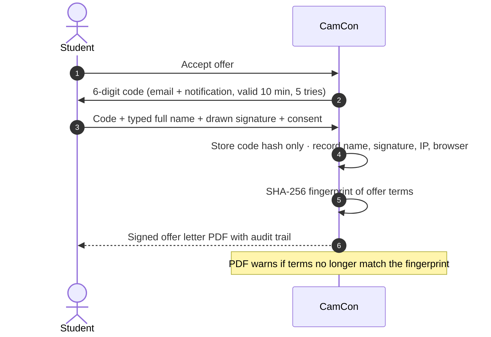
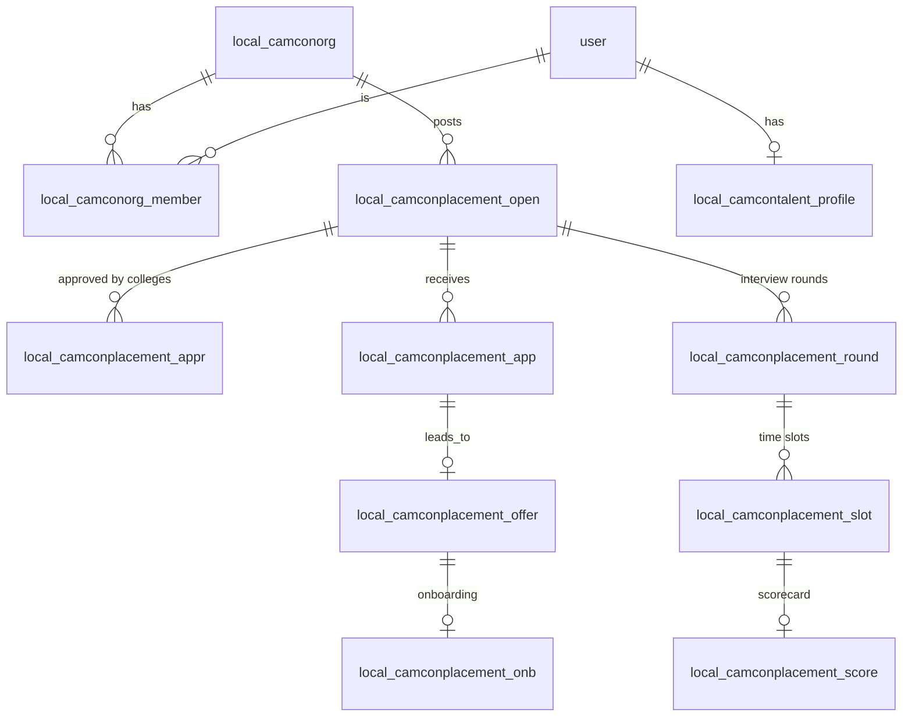

# CamCon — Campus Connect

**One platform where colleges teach, companies post real work and hire, and students go from learning to a job without leaving it.**

[← All projects](../README.md) · 🔒 **Source code:** private repo [`loganathan-expertise/camcon`](https://github.com/loganathan-expertise/camcon) · [Request access](https://github.com/loganathan-expertise/project-portfolio/issues/new?template=access-request.yml)

| | |
|---|---|
| **Domain** | EdTech · campus recruitment · corporate induction |
| **Type** | Greenfield platform built on Moodle LMS |
| **Status** | Release 0.5: core flow end to end, verified for every role |
| **Users** | Students, faculty, placement officers (TPO), recruiters, hiring managers, mentors, platform admin |

---

## The problem

Colleges, students and recruiters work in separate systems. Colleges run an LMS, companies run an ATS, and placements move through spreadsheets and email. CamCon puts learning, real project work, hiring and onboarding in one place:

- **Colleges** publish courses and learning paths, approve which openings their students see, and track placement readiness.
- **Companies** post projects, internships and jobs, run interviews, make offers and onboard new hires with an induction programme.
- **Students** learn, build a verified profile and resume, take part in challenges, apply, interview, sign offers electronically and complete onboarding.

## Tech stack

| Layer | Technology |
|---|---|
| Platform | Moodle LMS 5.3 (LTS) |
| Language | PHP 8.4 / 8.5 |
| Custom code | 1 Boost child theme + 7 local plugins (Moodle public APIs only, **no core changes**) |
| Database | MariaDB (PostgreSQL supported) |
| Mobile | Moodle app with custom CamCon pages (Ionic templates via `db/mobile.php`) |
| Integrations | Jitsi video rooms, WhatsApp (Meta Cloud API, pluggable), HR exports (CSV / Excel / JSON), signed webhooks, REST web services, optional AI match explanations |
| Ops | Moodle cron (every minute), scheduled tasks, scripted install, upgrade and demo-data setup |

## Architecture

| Component | Responsibility |
|---|---|
| `theme_camcon` | Design tokens, navigation, home page (banner slider, numbers, audiences, open projects), organisation colours inside organisation spaces |
| `local_camconorg` | Organisation applications and approval, provisioning, branding, members and verification, bulk upload, subscriptions and renewals, partnerships (MoU), offboarding with data export |
| `local_camconplacement` | Openings and eligibility, college approval per opening, applications, interview rounds, slots, panels and scorecards, offers with hiring-manager approval and e-signature, onboarding, HR integration, project-course builder |
| `local_camcontalent` | Career profile, talent-pool opt-in, six-part readiness score, PDF resume, talent search |
| `local_camconengage` | Challenges and hackathons, verifiable certificates, learning paths, content library, WhatsApp alerts |
| `local_camconhelp` | Help desk with routing, SLAs, escalation and ratings; help articles per organisation |
| `local_camconinsights` | Dashboards for the platform, each college and each company; CSV / Excel export |
| `local_camconmobile` | CamCon screens in the Moodle app (My CamCon, openings, challenges, help) |

### Tenancy model: soft tenancy

A marketplace needs companies to see students from every college, so CamCon uses **one site with organisation-scoped spaces** instead of hard isolation:

Visibility rules are enforced in code:
- A student sees an opening only after their college approves it.
- A profile is visible to recruiters only if the student opted in to the talent pool or applied to that company.
- Applying requires explicit consent to share the profile.

## End-to-end flow

### Offer e-signature

## Features

| Area | What's included |
|---|---|
| **Organisations** | Application and approval, provisioning, branding, member verification, bulk upload; yearly subscriptions with reminders (30/7/0 days), grace period and read-only mode when lapsed; offboarding with ZIP export; college–company partnerships |
| **Learning** | Books, pages, assignments with rubrics, quizzes (11 question types), SCORM, forums, completion; learning paths with verifiable certificates; one-click course templates |
| **Openings and challenges** | Projects, internships and jobs with eligibility (branch, year, CGPA, one-offer policy); challenges and hackathons with teams, judges and a leaderboard |
| **Interviews** | Rounds, interviewer slots, self-booking with calendar events, Jitsi video rooms, panels with one scorecard per member, company question banks |
| **Hiring** | Shortlist, select, offer, hiring-manager approval, built-in e-signature, offer letter PDF; HR exports, signed webhook on hire, REST API |
| **Projects** | An auto-built project course per opening: brief, forum, three milestones, rubric (code 25 · functionality 35 · docs 20 · demo 20) |
| **Onboarding** | Induction course on acceptance, joining checklist, buddy, 30/60/90-day check-ins, hiring-manager sign-off |
| **Readiness** | Profile, PDF resume, aptitude tests, mock interviews, six-part readiness score, rule-based matching with reasons, optional AI explanation |
| **Support** | Help desk routed to the college, the company or the CamCon team; priorities and SLAs (urgent 4 h / 24 h … low 48 h / 240 h); escalation; help articles |
| **Insights** | Platform, college and company dashboards (funnel, time to hire, placements by branch, readiness); period filters; CSV / Excel |
| **Mobile** | Moodle app pages for My CamCon, openings, challenges and help, with CamCon styling |

## Data model (core placement tables)

## Engineering highlights

- **Zero core modifications.** Everything is standard Moodle plugins and public APIs (course and activity builder, question engine, completion, charts, mobile delegates), so upgrades stay routine.
- **Released in increments:** 0.1 → 0.1.1 → 0.2 → 0.3 → 0.4 → 0.5. Each release was verified in the browser for every role, using seeded demo organisations, students and recruiters.
- **Repeatable setup.** Numbered setup scripts handle install, configuration, demo data and publishing. A demo-data seed produces realistic states, such as backdated applications and pending interviews.
- **Privacy built in:** Moodle Privacy API, explicit consent to share profiles, scoped visibility.

## Roadmap

Coding labs (VPL / CodeRunner on Docker), Git repositories and a PR review board, billing and licensing (Razorpay), and production hardening (HTTPS, SMTP, backups).

---

[← All projects](../README.md) · 🔒 [Request code access](https://github.com/loganathan-expertise/project-portfolio/issues/new?template=access-request.yml)
