

# FinWise

**A loan and financial-product marketplace.** Individuals and small businesses compare offers from partner lenders, apply once, and follow their application through to disbursal. Channel partners source customers and earn payouts, and staff run sales, partner management and service in the CRM.

[← All projects](../README.md) · 🔒 **Source code:** private repo [`loganathan-expertise/finwise`](https://github.com/loganathan-expertise/finwise) · [Request access](https://github.com/loganathan-expertise/project-portfolio/issues/new?template=access-request.yml)

| | |
|---|---|
| **Domain** | FinTech · lending marketplace · B2C retail loans and B2B (SME) finance |
| **Type** | Rebuild of a 2014–15 enterprise CRM implementation from its original specification, on current open-source software |
| **Status** | CRM + portal built and verified end to end with demo data |
| **Users** | Customers, channel partners (DSAs), lender credit desks, call-centre executives, field sales, regional managers, channel team, executives |

---

## What was rebuilt

The original system was a SugarCRM 7 implementation with a third-party website and CTI. Its design documents covered a 12-step customer journey, field-level module definitions, website touchpoints, channel-partner empanelment and the user hierarchy. These were enough for an end-to-end rebuild:

| Then (2014–15) | Now |
|---|---|
| SugarCRM 7 (commercial) | **SuiteCRM 8.10** (open source) |
| Third-party website | **Laravel 13 portal** for customers, partners and lenders, built here |
| Real bank integrations | **Lender credit desk** in the portal (5 fictitious lenders) standing in for FI integration |
| SMS gateway / SMTP | Notifications recorded in the CRM through a single delivery hook point, ready for a real gateway |
| 17 near-identical product modules | One application model with product-specific answers stored as structured JSON |

## Tech stack

| Layer | Technology |
|---|---|
| CRM | SuiteCRM 8.10 (Symfony + Angular shell, legacy module layer) on PHP 8.2 |
| Portal | Laravel 13 on PHP 8.5 · Blade · custom CSS |
| Database | MariaDB 12 (dedicated instance): `finwise_crm`, `finwise_portal` |
| Integration | SuiteCRM V8 REST API with custom routes · OAuth2 client credentials · HMAC-SHA256 signed webhooks |
| Web server | Apache 2.4 with FastCGI (separate PHP runtimes for CRM and portal) |
| Docs | Architecture / design / flow document, user manual, installation guide (Markdown + PDF), Mermaid diagrams |

## Architecture

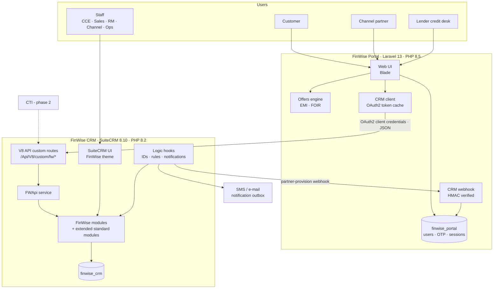

- **The CRM is the system of record.** Business rules run as logic hooks, so they apply equally to records created by staff, by the portal or by imports.
- **The portal holds only identities and short-lived data** (users, OTP codes, sessions). It reads and writes all business data through the CRM API, so there is one copy of every customer and application.
- **The CRM API enforces ownership.** An application is returned only to its own customer, partner or lender, and lender views mask the PAN.

## Customer journey

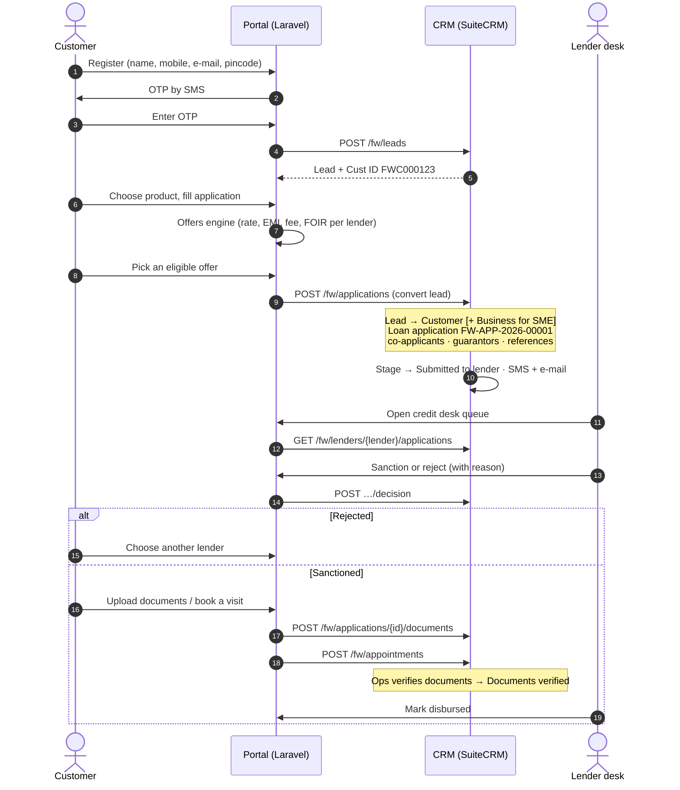

### Application stages

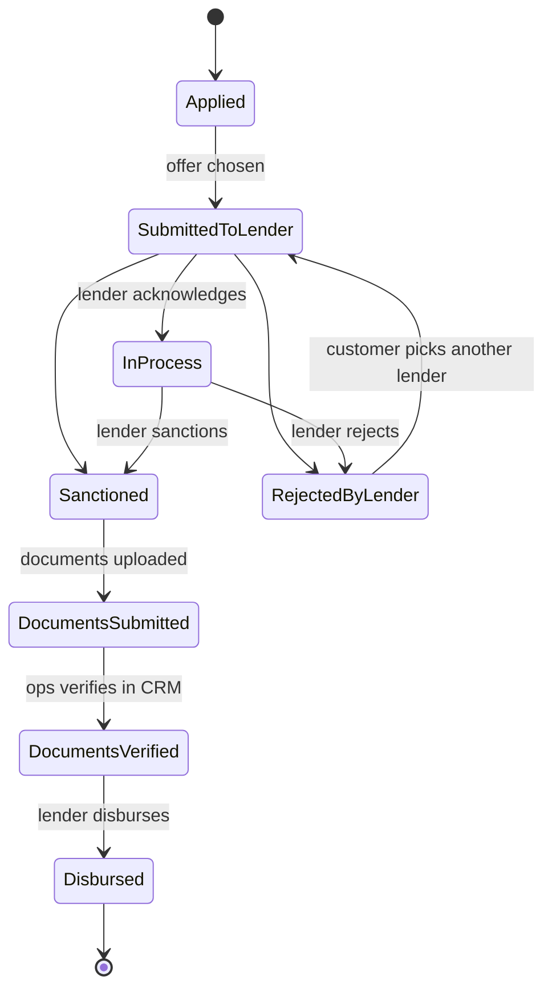

### Channel-partner empanelment (auto-approval)

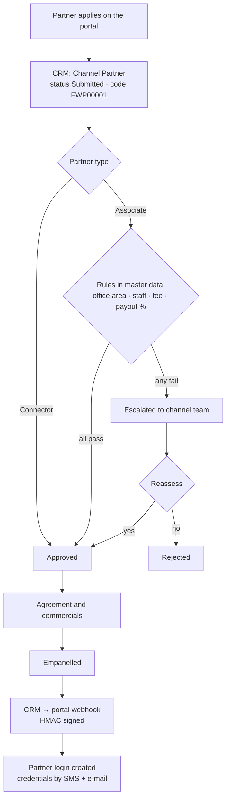

### Appointment allocation

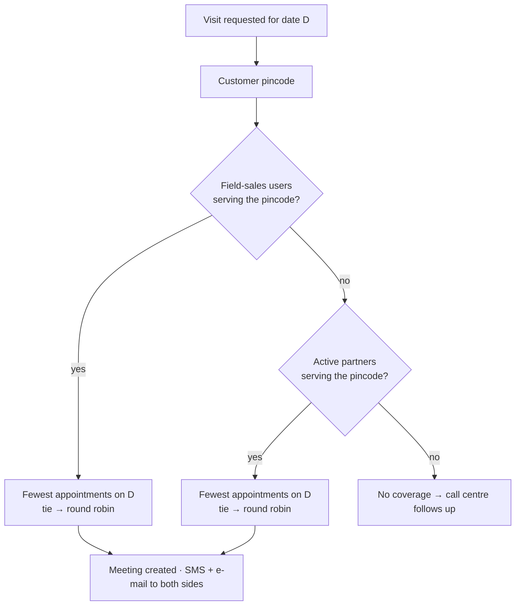

## Features

| Area | What's included |
|---|---|
| **Customer portal** | OTP registration, offers engine with EMI / FOIR across lenders, application wizard (retail and SME), tracker with stage history, document upload, appointments, service requests |
| **Partner portal** | Empanelment application, dashboard (leads, applications, appointments, earnings), partner lead entry |
| **Lender credit desk** | Queue, application detail with PAN masked, decisions (in process / sanction / reject with reason / disburse after document verification) |
| **CRM** | Leads, Customers, Businesses, Loan Applications, Appointments, Service Requests, Documents, Knowledge Base; 8 custom modules (Channel Partners, Branches, Co-Applicants, Guarantors, References, Shareholders, Empanelment Rules, Notifications) |
| **Business rules** | Auto-numbering (Cust ID, application no., partner code), stage notifications to customer and partner, stage history, empanelment checks, partner portal provisioning |
| **Catalogue** | 17 products in two segments (retail and SME), sub-products, managed from CRM dropdowns and read by the portal over the API |
| **Branding** | FinWise CRM theme; renamed modules carried through menus, quick-create, labels and "related to" lists |

## Data model

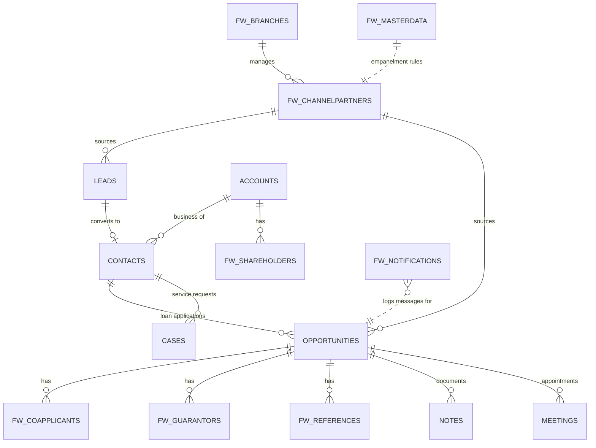

## Security

- **Portal authentication:** bcrypt passwords, login throttling, and a 6-digit mobile OTP (stored hashed, 10-minute validity, limited attempts and resends). Partners must change their password at first sign-in.
- **Authorisation:** role middleware (customer / partner / lender) on every route; record-ownership checks in the CRM API.
- **Integration:** OAuth2 client credentials (portal → CRM), HMAC-SHA256 signed webhooks (CRM → portal), CSRF on all forms.
- **Input handling:** server-side validation of PAN, GSTIN, IFSC, pincode and mobile numbers; MIME sniffing on uploads. Only `public/` is web-visible.

## Screens

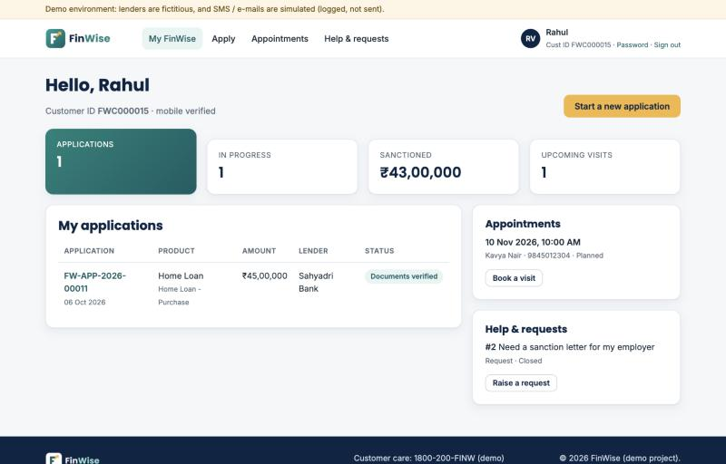
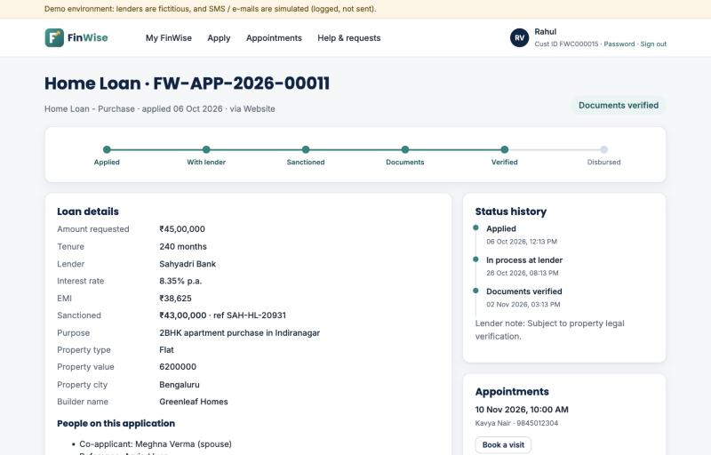

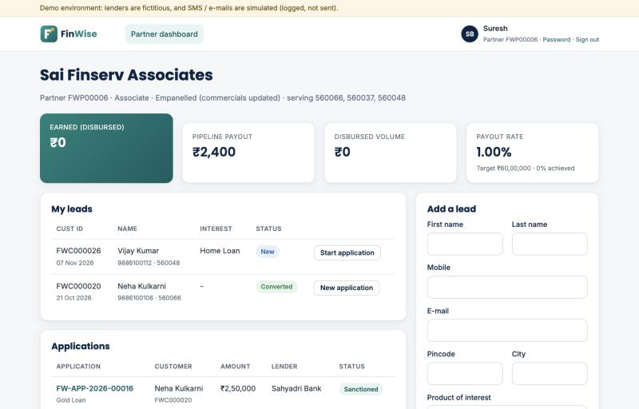
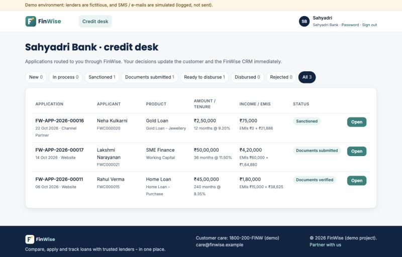

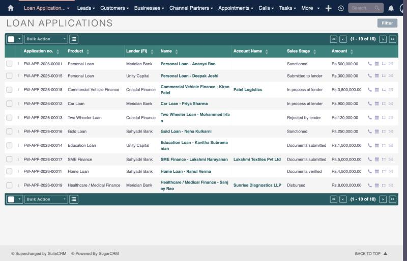

## Next phase

CTI integration, real SMS gateway and SMTP, real lender APIs, partner sub-users per branch, a report pack.

---

[← All projects](../README.md) · 🔒 [Request code access](https://github.com/loganathan-expertise/project-portfolio/issues/new?template=access-request.yml)
