

# PartsGrid

**A multi-tenant retail, rental and delivery platform for branded two-wheeler and four-wheeler spare parts.** It covers POS, B2B garage accounts on credit, purchasing with vendor drop-ship, stock across stores and warehouses, tool rentals, home delivery with OTP proof, and installable mobile apps.

[← All projects](../README.md) · 🔒 **Source code:** private repo [`loganathan-expertise/partsgrid`](https://github.com/loganathan-expertise/partsgrid) · [Request access](https://github.com/loganathan-expertise/project-portfolio/issues/new?template=access-request.yml)

| | |
|---|---|
| **Domain** | Retail · automotive aftermarket · B2B / B2C commerce (India: GST, HSN, MRP) |
| **Type** | Greenfield multi-tenant SaaS: architecture design plus a working prototype |
| **Status** | v0.3 working prototype of Phase 1 (web back office, POS, B2B portal, 3 PWAs) |
| **Users** | Business owners, store managers, cashiers, purchase, warehouse, accountants, auditors, delivery riders, garages and dealers (B2B), consumers, platform super admin |

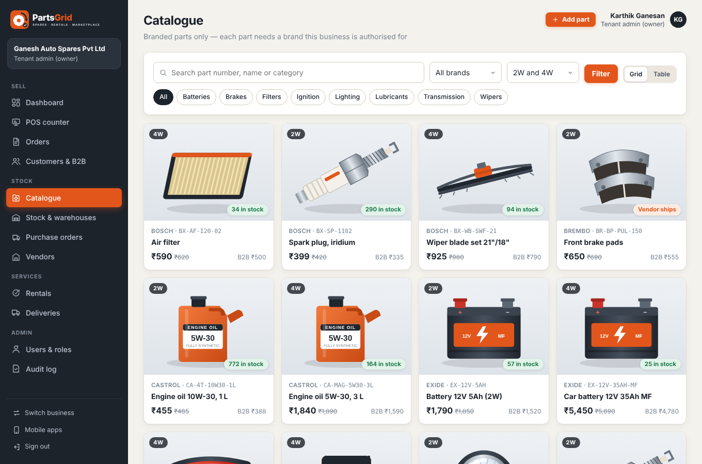

---

## Business in one paragraph

Each tenant is a parts business. It buys from vehicle manufacturers and authorised distributors, holds stock in stores and warehouses, and sells through POS counters, a web store, mobile apps and a B2B portal for garages, dealers and fleets. When no location has stock, the authorised vendor ships directly to the buyer (drop-ship). Tools and standby parts can be rented, and orders are delivered by the business's own riders or by partners, with OTP proof of delivery.

## Core flow: order allocation

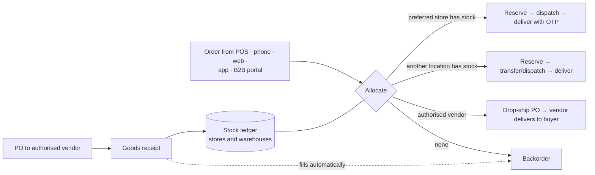

## Architecture

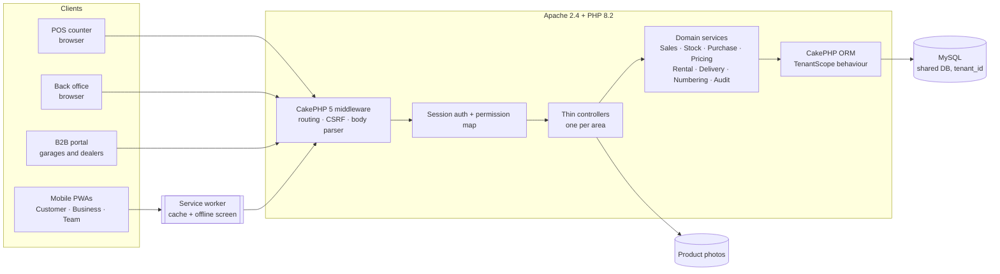

**Every request runs inside one tenant.** The session sets the `TenantContext`, and the `TenantScope` ORM behaviour adds `tenant_id` to every query and refuses cross-tenant writes. Business rules live only in domain services and run in database transactions, so the web screens, the mobile apps and the future API share the same rules.

### Key design decisions

| Topic | Decision |
|---|---|
| Shape | Modular monolith on CakePHP 5 (one module per bounded context); async workers later |
| Tenancy | Shared database with `tenant_id` on every tenant-owned row. Guard 1: ORM behaviour. Guard 2 (target): PostgreSQL row-level security |
| Identity | Global staff logins with per-tenant memberships and roles; tenant-scoped B2B / B2C logins; platform super admin |
| Access | Permission catalogue (20 permissions) and 8 role templates per tenant, checked server-side on every action |
| Catalogue | Branded parts only: a part needs a brand the tenant holds a valid authorisation for. Prices are capped at MRP; GST by HSN |
| Stock | Append-only stock ledger with reservations; transfers and adjustments are ledger entries |
| Money | GST-inclusive prices; CGST + SGST within a state, IGST across states (from the GSTIN state code); gapless invoice series per location |
| Credit | B2B credit limit and days; over-limit orders go to credit hold; overrides are audited |
| Rentals | A separate serial-tracked pool, never saleable stock; deposits and per-day rent |
| Delivery | One job model for own riders, agencies and API partners; customer OTP is the proof of delivery |

## Features

| Area | What it does |
|---|---|
| **Multi-tenancy** | Many businesses on one database, strictly isolated; staff can belong to several businesses and switch between them |
| **POS counter** | Search by part number or vehicle, customer-specific prices, cash / UPI / card / credit, instant GST invoice |
| **Orders** | One order model for POS, phone, web, app and B2B, with automatic allocation (store → any location → vendor drop-ship → backorder) |
| **B2B** | Account onboarding and approval, credit limits and holds, portal users with order limits, contract prices |
| **Purchasing** | Vendor brand authorisations with expiry, POs, goods receipts that fill backorders, drop-ship POs |
| **Stock** | Ledger with balance after every move, reservations, transfers, adjustments, cycle counts |
| **Rentals** | Serial-tracked tool pool, deposits, per-day rent with late days, damage and maintenance |
| **Delivery** | Jobs on dispatch; own riders, agencies or API partners; OTP proof; retry after a failed attempt |
| **Mobile apps** | Customer, Business and Team apps on live data, installable as PWAs with an offline screen |
| **Audit** | Every money, stock, credit and delivery action is logged |

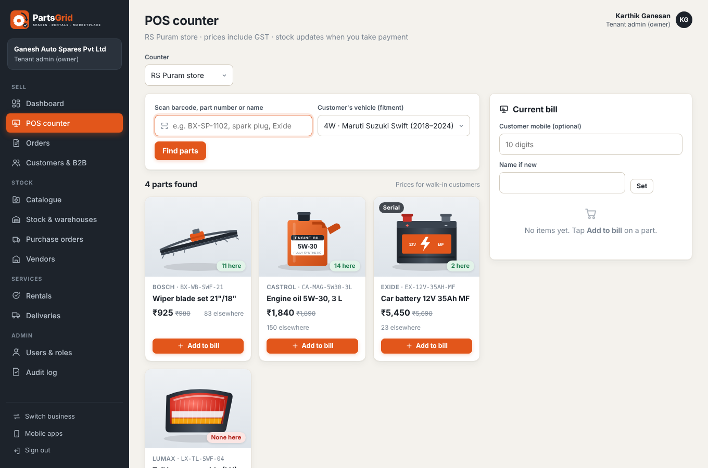
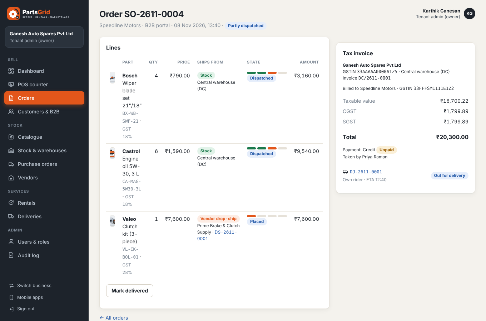

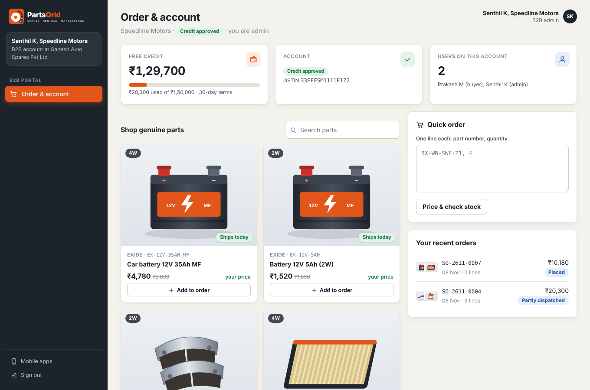
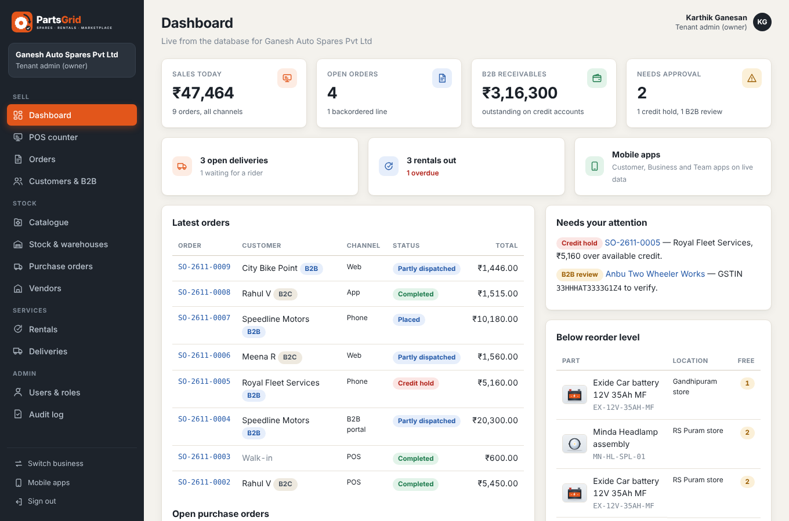

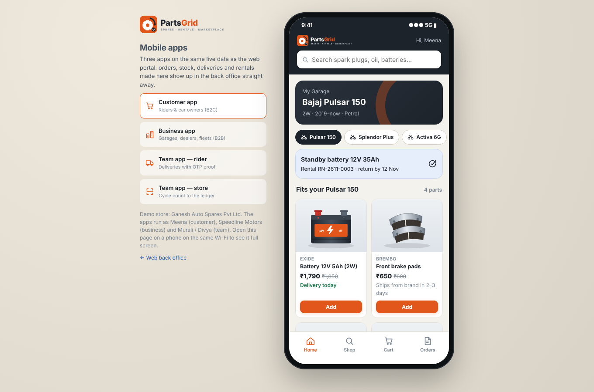
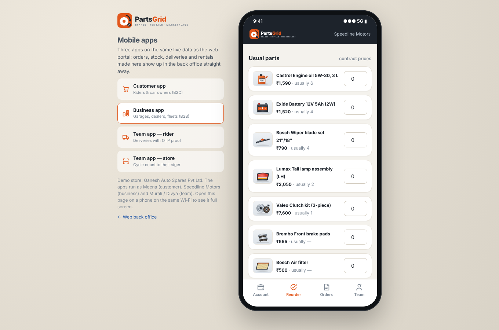
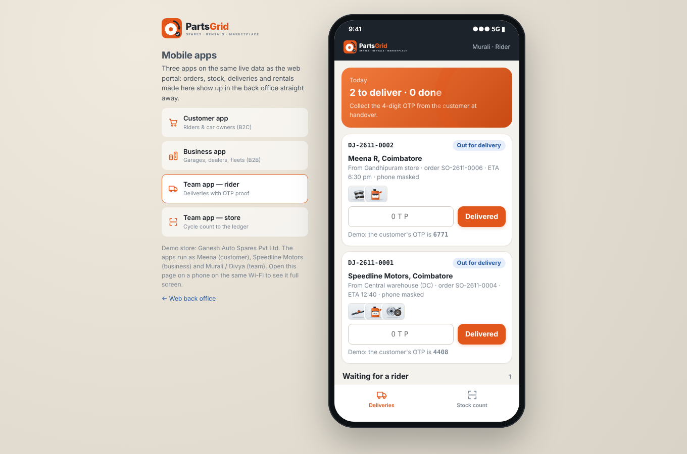

## Tech stack

| | Prototype (this build) | Production target (designed) |
|---|---|---|
| Backend | PHP 8.2 · CakePHP 5.1 | PHP 8.4 · CakePHP 5.4 · Nginx + PHP-FPM |
| Database | MySQL 5.7 (SQLite for tests) | PostgreSQL 17 + PostGIS, row-level security, read replica |
| Auth | Session login, bcrypt, rate limit, permission map | Authentication + Authorization plugins, staff MFA, JWT for apps |
| API | — | REST `/api/v1`, OpenAPI 3.1, idempotency keys, webhooks |
| Front ends | Server-rendered CakePHP templates, custom CSS design system | React 19 back office · Next.js storefront · offline POS PWA / Electron |
| Mobile | 3 installable PWAs | React Native (Expo) apps |
| Platform services | — | Redis / Valkey · RabbitMQ · Apache Solr 9 · ClickHouse + Superset · S3 / CloudFront |
| Infra | Apache (MAMP) | Docker · AWS ECS Fargate · Terraform · GitHub Actions · OpenTelemetry |
| Quality | PHPUnit · PHPStan · Psalm · CakePHP code sniffer | + PHPStan level 8, deptrac, Rector, Playwright |

### Target deployment

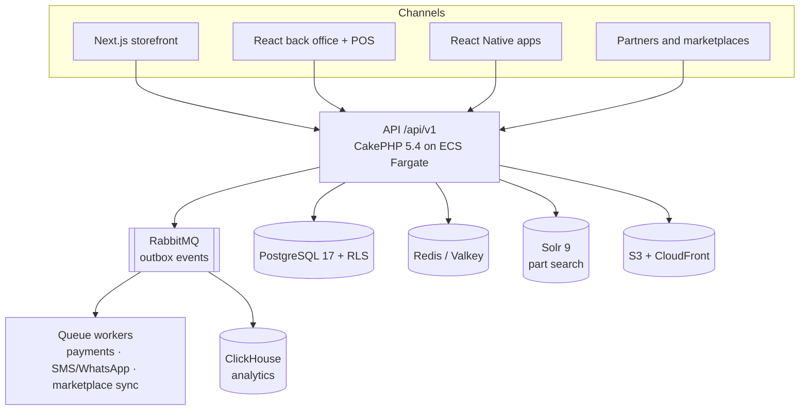

## Roadmap

1. PostgreSQL with row-level security; CakePHP 5.4 / PHP 8.4; MFA.
2. A versioned JSON API over the existing services, and React Native apps against it.
3. Payment and SMS gateways behind an integration module, with an outbox and queue workers.
4. Accounting ledger (receivables, GST returns) and legacy data import for a pilot tenant.
5. CI tests for tenant isolation, allocation, credit and GST rules.

---

[← All projects](../README.md) · 🔒 [Request code access](https://github.com/loganathan-expertise/project-portfolio/issues/new?template=access-request.yml)
