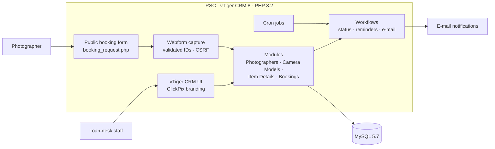
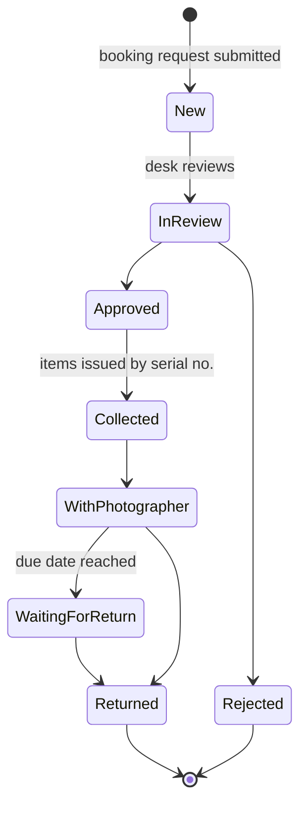
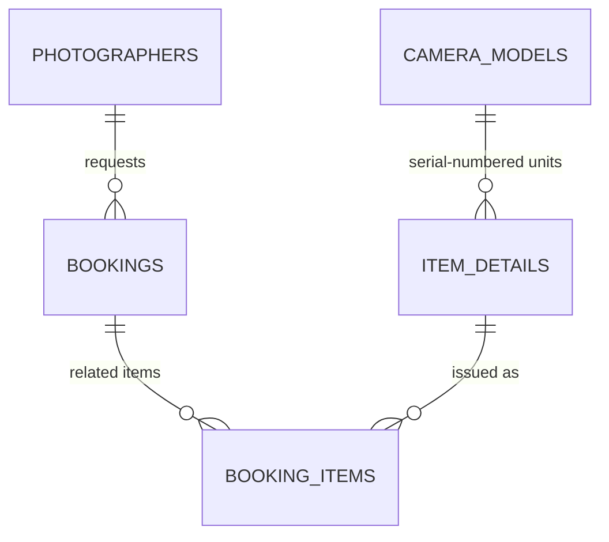

# RSC — Rent Sell Cameras (ClickPix)

**An equipment-loan and rental desk for a camera brand's professional services.** Photographers request camera bodies and lenses for events. The loan desk issues serial-numbered items with an accessory checklist, tracks collection and due dates, and records returns, including damage.

[← All projects](../README.md) · 🔒 **Source code:** private repo [`loganathan-expertise/rsc`](https://github.com/loganathan-expertise/rsc) · [Request access](https://github.com/loganathan-expertise/project-portfolio/issues/new?template=access-request.yml)

| | |
|---|---|
| **Domain** | Equipment rental · asset loan tracking · professional photographer services |
| **Type** | Revival, security hardening and full rebrand of a legacy vTiger CRM system |
| **Status** | Running on PHP 8.2, published with an anonymised sample database and full documentation |
| **Users** | Loan-desk staff, managers, photographers (public booking form) |

---

## What was done

| Workstream | Outcome |
|---|---|
| **PHP 8 compatibility** | Fixed the fatal errors in custom field types (Reference, URL, Password) that crashed every detail and edit view |
| **Security** | Closed a SQL injection in the public item search, removed the trust in client-supplied contact IDs in webform capture, added item-ID validation, fixed a stale CSRF token |
| **Rebrand** | Renamed the app and rebranded it as ClickPix (logo, colours, database strings, lens line names, `CPX` record numbering); repaired the serialized workflow tasks the rename touched |
| **Dependencies** | Disabled a third-party module designer in the shipped database and verified the custom modules work without it; documented how to re-enable it |
| **Packaging** | Anonymised sample database, rebuild script, architecture / user manual / installation guide (Markdown + PDF) |

## Tech stack

| Layer | Technology |
|---|---|
| Platform | vTiger CRM 8.0 (open source) |
| Language | PHP 8.2 |
| Database | MySQL 5.7 |
| Web server | Apache 2.4 |
| Custom modules | Camera Models, Item Details (serial-numbered stock), booking requests with accessory checklist |
| Automation | vTiger workflows (status changes, notifications), scheduled jobs (cron) |
| Public intake | Web booking-request form posting into the CRM |

## Architecture

## Booking lifecycle

Each issued item records its **serial number, collection date, due date, return status** (not returned / returned / returned with damage), **return date** and an **accessory checklist**: lens, battery, strap, hood, filter, flash, adapter, cables, eyepiece, body cap, memory card, front and rear caps, T-base.

## Data model

## Features

- Public booking-request form for photographers (event type, name, dates, description)
- Review and approval by the loan desk, then issue of specific serial-numbered units
- Accessory checklist at issue and at return; return status with damage recording
- Camera model catalogue and unit-level item tracking
- Workflows for status changes and notifications
- Standard CRM capabilities: contacts, documents, reports, dashboards, user roles

## Open items before production

CAPTCHA and rate limiting on the public form, and an offline-capable PDF export to replace the licensed PDF add-on.

---

[← All projects](../README.md) · 🔒 [Request code access](https://github.com/loganathan-expertise/project-portfolio/issues/new?template=access-request.yml)
